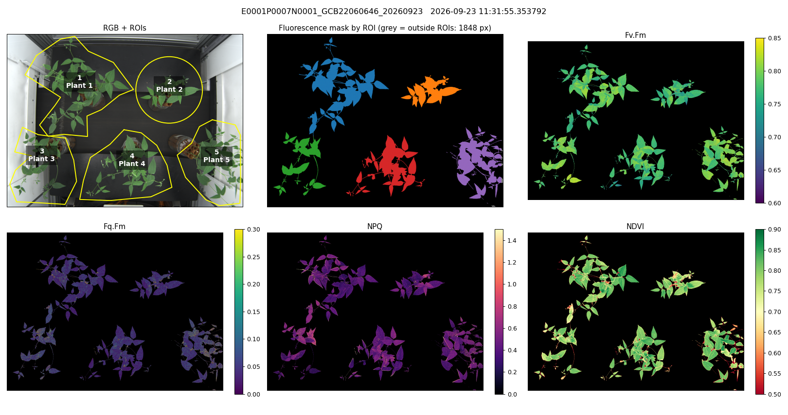
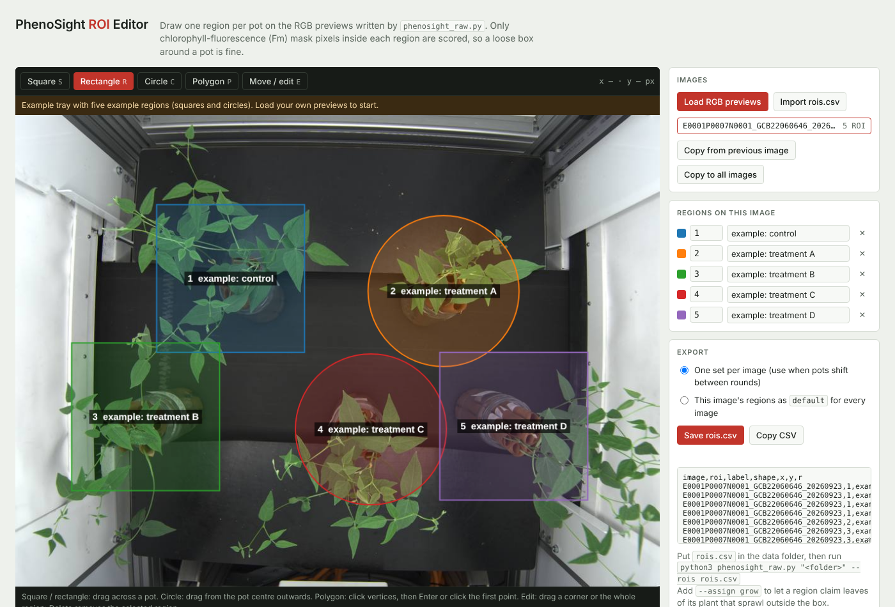
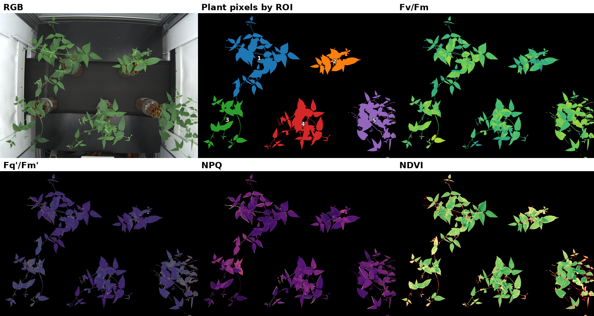

# Raw-file ROI pipeline (`phenosight_raw.py`)

Opens the raw PhenoVation CropReporter files (`HDR_*.INF` + `APH/CHL/CLR/PMT/SPC_*.DAT`)
without the vendor software, builds the plant mask from chlorophyll fluorescence, splits it
into regions of interest that you draw (one per pot or plant), and extracts the full
PhenoVation trait set per region. It also writes per-pixel trait maps for figures and for
measuring in Fiji.

Use it for experiments that do not fit the 5 × 4 tray layout of the
[Arabidopsis tray pipeline](../arabidopsis_tray_pipeline/): larger plants, a few pots per
image, irregular layouts, or any experiment where you want to place the regions yourself.



## Files

| File | Purpose |
| --- | --- |
| `phenosight_raw.py` | The pipeline (command-line tool) |
| `roi_editor.html` | Browser tool for drawing regions on the RGB previews and saving `rois.csv` |
| `examples/rois_example.csv` | An example ROI file (circles and polygons) |
| `requirements.txt` | Python packages |

## Quick start

```bash
pip install -r requirements.txt

# 1. RGB previews to draw regions on
python3 phenosight_raw.py <data_folder> --previews-only

# 2. draw regions: open roi_editor.html in a browser, load the previews, save rois.csv into <data_folder>

# 3. analysis
python3 phenosight_raw.py <data_folder> --rois rois.csv
python3 phenosight_raw.py <data_folder> --rois rois.csv --assign grow --tiff   # sprawling plants; also export TIFF stacks
```

`<data_folder>` holds the `HDR_*.INF` files and the matching `.DAT` files of one or more
imaging occasions. Results go to `<data_folder>/open_pipeline/` unless `--out` is given.

## Drawing regions



Open `roi_editor.html` in any browser (no installation, nothing is uploaded). Load the RGB
previews written by `--previews-only`, draw one region per pot as a square, rectangle, circle
or polygon, label it, and save `rois.csv`. Regions can be copied from the previous image or to
all images, or exported once as `default` for every image when pots do not move.

`rois.csv` columns: `image, roi, label, shape, x, y, r`.

- `image` is the HDR stem (e.g. `E0001P0007N0001_GCB22060646_20260923`), a plant number
  (`P0007`) or `default`.
- `shape` is `square`, `rect`, `polygon` (one row per vertex) or `circle` (one row: center `x, y`
  and radius `r`).
- Coordinates are pixels in the 2048 × 1500 image.

Only fluorescence-mask pixels inside a region are scored, so a loose outline is fine.

- `--assign inside` (default): mask pixels inside the region count. Where regions overlap, the
  lower region number wins.
- `--assign grow`: each region is a seed, and every leaf connected to it along the mask goes to
  the nearest region. Use this when plants sprawl past their outline.
- Without an ROI file, pots are found automatically from the RGB image (`--n-pots`, default 5).
  This is a fallback; use drawn regions for real analyses.

## Traits

Per region, plus `All` (the union of all regions), and per tissue class in the `Tissue` column:
`whole`, `leaf`, `leaf_core` (leaf without its rim) and `stem` (structures narrower than
`--stem-width`, default 8 px: stems and petioles). Switch the tissue split off with
`--no-tissues`.

- **Chlorophyll fluorescence:** `Fv.Fm`, `Fq.Fm` (Fq'/Fm'), `NPQ`, `qP`, `qN`, `qL`, `phiNO`,
  `phiNPQ`, `npq.t`; medians for Fv/Fm, Fq'/Fm' and NPQ.
- **Spectral:** `ChlIdx = (1/R_rededge − 1/R_nir)·R_nir`, `AriIdx = (1/R_anth − 1/R_rededge)·R_nir`,
  `NDVI`, `Abs = 1 − R_red/R_farred`.
- **Color and size:** mean `R`, `G`, `B`, `Hue`, `Area.px`, `Perimeter.px`, `ConvexArea.px`,
  `Solidity`, `Height.px`, `Width.px`, `nPieces`; `Area.mm2` when `--px-per-mm` is given.
- `TOE.h` = hours since the earliest image in the folder.

Each trait is computed per pixel with the PhenoVation formulas, gated to a plausible range, and
averaged over the region. Column names follow the facility's R conventions, one row per region,
so no Fv/Fm split-row fix is needed downstream.

Not available: `qE` and `qI` (need a second dark-adapted pulse, not saved with
`SaveAllFrames = 0`), and ETR (needs the actinic light intensity, not in the INF).

## Plant mask

The mask is Fm (dark-adapted maximum fluorescence) above the instrument's own threshold
(`TmPamMaskLevel` in the INF, typically 2000 counts; override with `--mask-level`). Objects
smaller than 30 px are removed and holes smaller than 200 px filled. Background Fm is about
20 counts and leaves 4,500–15,000, so the result is not sensitive to the threshold.

## Outputs

| Output | Contents |
| --- | --- |
| `PS2_traits_per_ROI.csv` | The trait table: one row per image × region × tissue |
| `qc/*_QC.png` | RGB with regions, mask colored by region, Fv/Fm, Fq'/Fm', NPQ and NDVI maps (figure at the top) |
| `qc/*_labels.npy` | Per-pixel region label image |
| `rgb_for_roi_picking/*_RGB.png` | Full-resolution RGB previews for the ROI editor |
| `trait_maps/<image>/<trait>.png` | Color trait maps on fixed scales, comparable across days |
| `trait_maps/<image>/color_scales.png` | Color bars and ranges for figure legends |
| `trait_maps/<image>/mask.png`, `roi_labels.png`, `tissue.png` | Plant mask, pixels by region, tissue classes |
| `trait_maps/<image>/values_for_Fiji/*.tif` | 32-bit per-pixel trait values (NaN outside the plant), mask and region labels, for measuring in Fiji |
| `tiff/*.tif` | Every `.DAT` as a 16-bit ImageJ stack with frame labels (`--tiff`) |



All maps are 2048 × 1500 on the same pixel grid as the RGB preview and the region coordinates.
The color ranges are fixed in `COLOR_RANGES` at the top of the script (for example Fv/Fm
0.60–0.85, NPQ 0–1.5, NDVI 0.5–0.9), so maps from different days can be compared directly.
Skip the maps with `--no-trait-tiffs`. TIFFs are LZW-compressed when the `imagecodecs` package
is installed.

## Raw format

- Every `.DAT` file is headerless little-endian uint16, stored column-major as
  `(n_frames, ImageCols = 2048, ImageRows = 1500)`; the script transposes to
  `(n, 1500, 2048)` landscape images (the same convention as PlantCV).
- `HDR_*.INF` is plain `key=value` text; `TimeStamp` is a Delphi serial date (days since
  1899-12-30, decimal comma), in instrument local time.
- Reflectance = counts / 65535 (leaf NIR ≈ 0.50, red ≈ 0.06).

| File | Frames |
| --- | --- |
| PMT | 0 Fdark · 1 F0 · 2 Fm · 3 Fdarksat · 4 Flight · 5 Fs' · 6 Fm' · 7 Flightsat · 8 F0' |
| CLR | Red · Green · Blue |
| SPC | Anthocyanin (~540 nm) · red edge (~710 nm) · NIR (~770 nm) |
| APH | Red · far-red (absorptance module) |
| CHL | Fdark · Chl |

The PMT frame order is not documented by the vendor. It was inferred from the frames themselves
and then confirmed against the vendor's own trait export on the same images: Fv/Fm r = 1.00,
NPQ 0.97, Fq'/Fm' and qP 0.88 (see the
[Arabidopsis tray pipeline README](../arabidopsis_tray_pipeline/README.md)).

## Known limitations

- `Abs` is relative: the APH bands use their own shutter settings. Compare it within an
  experiment only.
- The `Chl` frame of the CHL file has carried no signal in the files seen so far.
- Overlapping canopies cannot be separated perfectly in a top view. With `inside`, leaves in an
  overlap go to the lower region number; with `grow`, to the plant they connect to.

Contact: Magdalena M. Julkowska, Director, PhenoSight Facility, Boyce Thompson Institute
(mmj55@cornell.edu).
